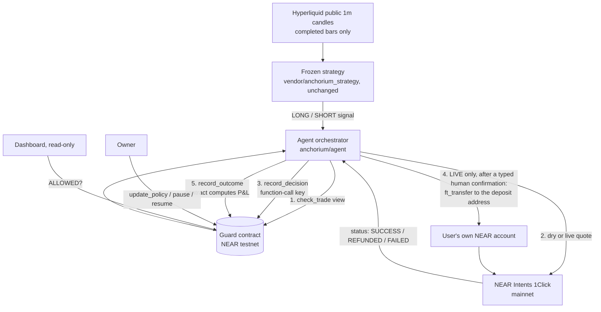

# Anchorium

Anchorium is an autonomous trading agent whose risk limits live in a NEAR smart contract. Before any trade it
asks the contract, journals the decision on-chain, and settles spot swaps through NEAR Intents (1Click) into
the user's own account.

**The problem**

- You have to trust a trading bot to follow its own risk rules. When it breaks one, nobody sees it.
- A bot's track record is usually a screenshot, not a history anyone can verify.
- The kill switch usually lives inside the same software it is supposed to stop.

## Demo

- Demo video / X post: `TODO_DEMO_URL`
- No hosted deployment. Everything below runs locally against the live testnet contract.
- Dashboard (`make dashboard`), a real capture of the live contract on 2026-11-11:

  

- A paper trade on live signals, with every fee itemized: [docs/paper_trade_report.md](docs/paper_trade_report.md)

## How NEAR is used

| Piece | Where | Check it |
|---|---|---|
| Guard contract (Rust, near-sdk 5.30.1) | `guard.anchorium-team.testnet` | [explorer](https://testnet.nearblocks.io/address/guard.anchorium-team.testnet), deploy + init tx [2jNynPX3…](https://testnet.nearblocks.io/txns/2jNynPX3pzh2JKLBdpcVh1NTgyUWGLmFTpJzCra4prRS) |
| Same wasm, never journaled to, for the keyless demo | `demo.anchorium-team.testnet` | [explorer](https://testnet.nearblocks.io/address/demo.anchorium-team.testnet) |
| Owner (sets policy, pauses) | `anchorium-team.testnet` | full-access key |
| Agent sub-account | `agent.anchorium-team.testnet` | **only** a function-call key (see below) |
| Settlement | NEAR Intents 1Click API, mainnet | `anchorium/near/intents.py` |

**On-chain code hash.** The guard's `code_hash` is `9G9w6hEmWJ9VmJ2R5BavB4gfGmZwUCCGYvhLPDyqQGfT`, the base58
form of the sha256 in [contracts/anchorium-guard/res/SHA256SUMS](contracts/anchorium-guard/res/SHA256SUMS)
(`7abf4ecc…`). `make demo` prints it from the chain.

**The agent's key can only journal.** Its full-access key was deleted (tx
[86WYN7Ro…](https://testnet.nearblocks.io/txns/86WYN7RoR1PNERjpSzspQXJ6uDX2fqnGP4m3LLrGyPq8)). What is left:

```sh
curl -s https://rpc.testnet.fastnear.com -H 'Content-Type: application/json' -d '{"jsonrpc":"2.0","id":1,"method":"query",
  "params":{"request_type":"view_access_key_list","finality":"final","account_id":"agent.anchorium-team.testnet"}}'
```

This returns exactly one key, `ed25519:6Uv5zLri3SzPNx15BV8jATcjVjPcWndD4GoVZBKx5xfz`, with permission
`FunctionCall { receiver_id: guard.anchorium-team.testnet, method_names: [record_decision, record_outcome] }`.
That key cannot pause, change the policy or transfer NEAR. The sandbox test
`function_call_key_can_journal_but_nothing_else` proves this against a local node (`InvalidTransaction`). The
Python client also refuses to load a full-access key as the agent signer (`load_function_call_signer`).

**The 1Click flow.**

1. `GET /v0/tokens` for reference prices.
2. `POST /v0/quote` (`dry: true` unless LIVE), then the slippage gate and the on-chain decision.
3. LIVE only: an NEP-141 `ft_transfer` to the quote's deposit address, then `POST /v0/deposit/submit`.
4. `GET /v0/status` until SUCCESS, REFUNDED, FAILED or INCOMPLETE_DEPOSIT, then the on-chain outcome.

Every status maps to where the funds are (`FUNDS_LOCATION` in `intents.py`). Real quotes show a **20 bps**
unauthenticated fee (`appFees`); the 1Click docs say 0.25%.

**Evidence on the guard so far.** Everything below is `DRY_RUN`; the live micro-trade has not run yet.

| # | Decision | Verdict | Tx |
|---|---|---|---|
| 0 | BUY wNEAR $2.00 (replay signal) | ALLOWED, paper fill journaled | [Bv9EqBEs…](https://testnet.nearblocks.io/txns/Bv9EqBEs4Rv6Vory6RB5Zmcjyst2wRhewswMSMHGHLM9), outcome [4ot1qpSB…](https://testnet.nearblocks.io/txns/4ot1qpSBo53RBzeDLNCZvZWZyxjho5uxZNnxGMYyf9ai) |
| 1 | SELL wNEAR, worst case 162 bps | REJECTED `SLIPPAGE_ABOVE_MAX` | [DJC9Ldk6…](https://testnet.nearblocks.io/txns/DJC9Ldk68Pv7EsdfhPkUSo7GxD8WuwPnB8qWcQBheCP6) |
| 2 | Simulated compromised agent asks for $4.99 and claims "allowed" | REJECTED `NOTIONAL_ABOVE_MAX`, `verdict_override` event | [4KxLnhn9…](https://testnet.nearblocks.io/txns/4KxLnhn9mdtaQq5wVpxK525yMyBsdpfyKNfqw1aBbAWM) |
| 3 | Manual exit, worst case 102 bps | REJECTED `SLIPPAGE_ABOVE_MAX` | [B32FQ8EE…](https://testnet.nearblocks.io/txns/B32FQ8EECjctfYuvh4eUb8wzSeNmvJDD7mMJxukcijqM) |
| – | Owner raises `max_slippage_bps` from 100 to 150 (`policy_updated` event) | owner tx | [DExrWkb3…](https://testnet.nearblocks.io/txns/DExrWkb3p8zQauc31dsqhCA6M9jfbWvd4YLWh4XX75df) |
| 4 | Manual exit, worst case 93 bps | ALLOWED; the contract computed paper P&L +$0.03 | [FbJB9NrE…](https://testnet.nearblocks.io/txns/FbJB9NrEdh78WEuhQtrqX36dAyTEacoW4mZvMnXrLRqV), outcome [D54bhC4d…](https://testnet.nearblocks.io/txns/D54bhC4dGUvMYX6XKZySn5dKPtf1Zj6coimfybwqbNrw) |

The paper trade's own decisions are in [its report](docs/paper_trade_report.md). `make status` lists the latest.

NEAR AI Cloud and Chain Signatures are **not** used yet (see the roadmap).

## Quickstart for judges

Prerequisites: Python ≥ 3.11 (tested with 3.12.5), `make`, `git`, internet access. Path B also needs
[near-cli-rs](https://github.com/near/near-cli-rs) 0.31.1. Rust is needed only to rebuild or test the contract:
toolchain 1.95.0 is pinned in `rust-toolchain.toml`, plus cargo-near 0.23.0.

### Path A: zero keys, zero funds (about 1 minute)

1. `git clone https://github.com/Adesh2204/anchorium-near && cd anchorium-near`
2. `make setup` → you will see `setup OK: Python 3.x.y`.
3. `make freeze` → you will see `"vendored_files_verified": 13`, `"parameter_count": 28` and `"passed": true`.
4. `make demo` → what you will see:
   - three recorded live-market signals (NEAR, BTC, ETH) go through the deployed contract's `check_trade`;
   - each gets a **real** 1Click dry quote;
   - the demo prints the exact `record_decision` call the agent would sign;
   - a simulated compromised agent asking for $4.99 gets `NOTIONAL_ABOVE_MAX`;
   - it ends with the real on-chain journal and the stats of `guard.anchorium-team.testnet`.

   Expected output: [docs/JUDGES.md](docs/JUDGES.md).
5. `make status` → the policy, roles, stats, open positions and latest decisions, read from the chain as JSON.
6. `make dashboard`, then open http://127.0.0.1:8000 → a read-only view of the same contract.

### Path B: your own contract, journaled on-chain (about 3 minutes)

```sh
OWNER=judge-$RANDOM.testnet make demo-onchain
```

This creates a free faucet account `OWNER`, plus `guard.OWNER` and `agent.OWNER`. It deploys the committed wasm,
grants the agent a function-call key, and runs the same replay with **real** `record_decision` and
`record_outcome` transactions on your contract. Each line prints a testnet explorer link. Keys go to
`~/.near-credentials`, never into the repo. No mainnet, no funds.

### Optional

- `make agent` runs the live loop on current candles. It stays DRY_RUN but journals with the agent key, so only
  the owner of a deployment can use it.
- `python -m anchorium paper-trade --inr 500` runs the paper session behind
  [docs/paper_trade_report.md](docs/paper_trade_report.md).

## Architecture



Decision flow for one signal (`anchorium/agent/orchestrator.py`):

1. A LONG signal becomes a BUY (USDC → asset). A SHORT becomes a SELL only when the guard shows an open
   position; a spot account cannot short.
2. `check_trade` is a free view call. If it returns `POSITION_ALREADY_OPEN`, `COOLDOWN` or
   `MAX_OPEN_POSITIONS`, the agent stops here instead of spending the daily decision cap.
3. 1Click quote. The worst-case slippage is the value of `minAmountOut` against the input, both at `/v0/tokens`
   reference prices. It covers fees, price impact and tolerance.
4. `record_decision` with the agent's own verdict. The final verdict is the contract's check **and** the agent's
   verdict: the agent can veto a trade but never override a rejection.
5. DRY_RUN: `record_outcome` with the quote's amounts (a paper fill). LIVE: deposit, track the 1Click status,
   then `record_outcome` with the settled amounts.

Each step is checkpointed in SQLite (WAL) before its side effect, so a restart resumes instead of repeating. The
contract is idempotent per `signal_hash`. An interrupted LIVE deposit is parked as `NEEDS_REVIEW` for a human.

## Safety model

**What the contract enforces** (`contracts/anchorium-guard/src/lib.rs`):

- **Roles.** Only the owner can call `update_policy`, `pause`, `resume` and `set_agent`. Only the agent can call
  `record_decision` and `record_outcome`.
- **Entry limits:**
  - allowed assets;
  - max notional per trade ($2.00);
  - entries per day (10) and decisions per day (100);
  - cooldown (60 s);
  - max open positions (1);
  - max slippage (150 bps);
  - pause.
- **Daily loss cap ($1.00).** The contract computes realized P&L itself from the settled amounts; the agent
  cannot report its own P&L. The contract **auto-pauses** when the cap is hit.
- **Exits.** They ignore pause and the entry limits but need an open position tracked by the contract, so the
  kill switch never traps a position.
- **Overrides.** A decision the agent marks "allowed" but the contract rejects is stored as rejected and emits
  `verdict_override`.
- Every decision and outcome is a NEP-297 event.

**What the agent enforces** (`anchorium/near/live.py`, `orchestrator.py`):

- **DRY_RUN by default.** LIVE needs all of these:
  - `LIVE=1` **and** `DRY_RUN=0`;
  - `MAX_LIVE_NOTIONAL_USD` ≤ 2 (a hard cap) and a session total ≤ $5;
  - an ALLOWED on-chain decision and an unexpired quote;
  - a human typing the exact confirmation phrase in an interactive terminal. The prompt shows the token, amount,
    quote, guaranteed minimum, worst-case slippage and deposit address.
- It never deposits without an ALLOWED decision recorded on-chain for that exact trade.
- It never sells more than the account holds.
- A SUCCESS without a settled amount, or an interrupted deposit, goes to `NEEDS_REVIEW`; the agent never guesses
  an amount.

**Kill switch.** The owner calls `pause`: one transaction, no agent involvement. Entries stop at the next
`check_trade`, and exits stay possible. The contract also pauses itself at the daily loss cap.

**The limitation, plainly.** The guard runs on **testnet**; Intents settle on **mainnet**. The contract cannot
block a mainnet transfer. Enforcement is the agent refusing to deposit without an ALLOWED on-chain decision, and
every violation (an override, a rejected trade) is visible in the journal. Funds stay in your own account: the
agent holds no custody, 1Click pays out to your account and refunds to it, and your account's key signs the
deposit.

## Tests

| Command | What | Result (2026-11-11) |
|---|---|---|
| `make freeze` | the vendored strategy is byte-identical; freeze manifest checks | pass (13 files, 28 parameters) |
| `make test-py` | Python: 1Click client (mocked), LIVE gates, signal parity against the original source, orchestrator incl. crash/resume, paper session, dashboard | **91 passed**, 1 deselected (network) |
| `.venv/bin/python -m pytest -m network` | one real 1Click dry quote | opt-in |
| `make contract-test` | Rust unit tests + sandbox tests on a local NEAR node | **40 passed** + **2 passed** |
| `make test` | all of the above except the network test | |

## Hackathon disclosure

- **Judged work:** `git diff baseline...hackathon-submission`
  ([compare](https://github.com/Adesh2204/anchorium-near/compare/baseline...hackathon-submission)). This repo
  was created during NEAR HACKATHON. Its first commit, tagged `baseline`, contains only the vendored strategy.
- **Prior work (not judged):** `vendor/anchorium_strategy/` is our team's earlier non-NEAR VWAP/EMA/ATR
  strategy, built for Perpetual Alpha, a separate trading competition. It is copied byte-identical;
  [SOURCE.md](vendor/anchorium_strategy/SOURCE.md) has the source commit and the SHA256 manifest.
- **New in the hackathon:**
  - the guard contract, its tests and the deploy scripts;
  - the 1Click client, the orchestrator and the LIVE gates;
  - the dashboard, the paper-trade session and these docs.
- **Libraries:**
  - Rust: near-sdk 5.30.1, near-sandbox 0.4, near-api 0.8.
  - Python: near-kit 1.3.0, httpx, FastAPI, uvicorn, pandas, numpy, pytest.
  - Deployment: near-cli-rs. The NEAR agent skills are in `.claude/skills/`.
- **AI-assisted code:** written with Claude Code.
- **Team:** Adesh, Parth.
- **Other hackathon projects led by us:** `TODO_TEAM_CONFIRM`

## Limitations and roadmap

- **The guard is on testnet, settlement on mainnet** (see the safety model). Roadmap:
  - a mainnet vault contract that holds the funds and releases them to a 1Click deposit address only for an
    ALLOWED decision, so the contract enforces the rules itself instead of the agent;
  - then Chain Signatures, so the vault can settle on other chains.
- **The trading account needs a full-access key.** NEP-141 `ft_transfer` needs a 1 yoctoNEAR deposit, which
  function-call keys cannot attach. Keep only a few dollars in it.
- **Live trading is unproven.** No mainnet trade has run yet. One human-confirmed $2 micro-trade is planned, and
  its transactions will be added here. All P&L shown so far is paper.
- **Slippage is measured against 1Click reference prices**, which ran 0.5–1% away from executable quotes in our
  measurements. That is why the owner raised the cap from 100 to 150 bps.
- **No strategy edge is claimed.** The strategy was built for perpetual futures; here it drives long-only spot.
  Its exit rule is new agent logic: sell on the next SHORT signal or after a timer.
- **The build is not reproducible.** The wasm is built with `cargo near build non-reproducible-wasm` (no Docker),
  so compare the hash instead.
- **Not used yet:** NEAR AI Cloud (a co-pilot whose rationale hash would go into `rationale_hash`) and Chain
  Signatures.

## License

[MIT](LICENSE)
