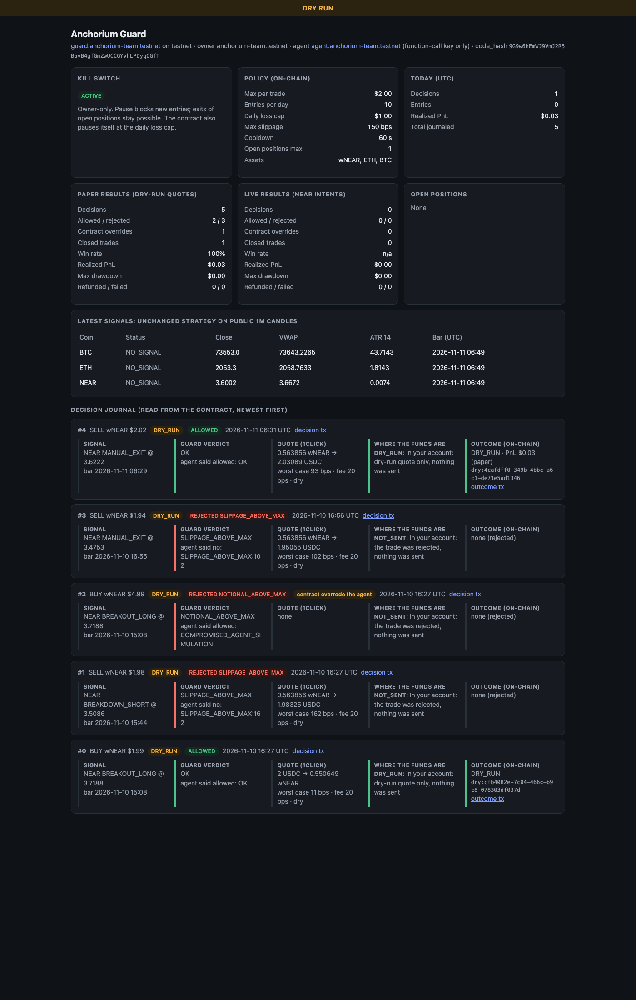
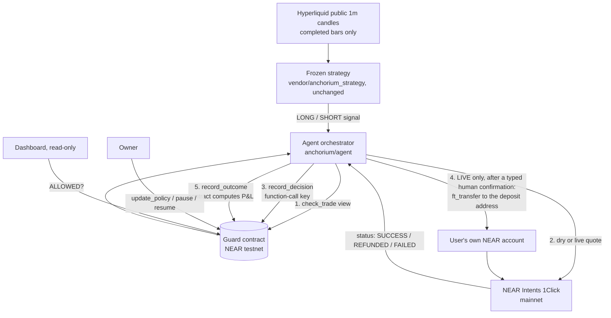

# Anchorium

Anchorium is an autonomous trading agent whose risk limits live in a NEAR smart contract. Before any trade it
asks the contract, journals the decision on-chain, and settles spot swaps through NEAR Intents (1Click) into
the user's own account.

> **PayPal AI Hackathon edition.** PayPal Checkout (Orders API v2, sandbox)
> funds the agent's budget, and an AI risk co-pilot (Google Gemini, `gemini-3.8-flash`) reviews every top-up before it is captured
> and every trade before it is journaled. The co-pilot can only veto; the NEAR contract still has the final word,
> and each AI review's hash is journaled on-chain in `rationale_hash`. Try it with zero keys: `make setup && make
> paypal-demo`. Full write-up, architecture and run steps: **[docs/PAYPAL_AI.md](docs/PAYPAL_AI.md)**.

**Version A (the trading mode we run):** long-only NEAR, entered on the unchanged frozen strategy's LONG signal.
It is **autonomous within owner-set limits; profit exits cover fees, gas and a 31.2% tax reserve; a -5% safety
stop and a time exit cap the downside**. Limits: $2 per trade, 1 open round, 3 rounds per session, an INR 20
session loss cap, a 1.6% round-trip cost filter, every leg checked by the guard and journaled on-chain. A regime
filter with bear rounds was researched and did not beat version A out of sample: see the honest
[regime backtest](docs/regime_backtest.md) (roadmap, not runtime).

**The problem**

- You have to trust a trading bot to follow its own risk rules. When it breaks one, nobody sees it.
- A bot's track record is usually a screenshot, not a history anyone can verify.
- The kill switch usually lives inside the same software it is supposed to stop.

## Demo

- Demo video / X post: `TODO_DEMO_URL`
- No hosted deployment. Everything below runs locally against the live testnet contract.
- Dashboard (`make dashboard`), a real capture of the live contract on 2026-11-11:

  

- Two paper trades on live signals, with every fee itemized:
  - BTC, exit on the next SHORT signal: 116 min, **−₹2.10** on ₹500 after fees ([docs/paper_trade_report.md](docs/paper_trade_report.md))
  - NEAR, exit only once the quote's guaranteed output covers every cost + $0.01: 3 min, **+₹1.97** on ₹500 after fees and gas ([docs/paper_trade_profit_report.md](docs/paper_trade_profit_report.md))

## How NEAR is used

| Piece | Where | Check it |
|---|---|---|
| Guard contract (Rust, near-sdk 5.30.1) | `guard.anchorium-team.testnet` | [explorer](https://testnet.nearblocks.io/address/guard.anchorium-team.testnet), deploy + init tx [2jNynPX3…](https://testnet.nearblocks.io/txns/2jNynPX3pzh2JKLBdpcVh1NTgyUWGLmFTpJzCra4prRS) |
| Same wasm, never journaled to, for the keyless demo | `demo.anchorium-team.testnet` | [explorer](https://testnet.nearblocks.io/address/demo.anchorium-team.testnet) |
| Owner (sets policy, pauses) | `anchorium-team.testnet` | full-access key |
| Agent sub-account | `agent.anchorium-team.testnet` | **only** a function-call key (see below) |
| Settlement | NEAR Intents 1Click API, mainnet | `anchorium/near/intents.py` |

**On-chain code hash.** The guard's `code_hash` is `9G9w6hEmWJ9VmJ2R5BavB4gfGmZwUCCGYvhLPDyqQGfT`, the base58
form of the sha256 in [contracts/anchorium-guard/res/SHA256SUMS](contracts/anchorium-guard/res/SHA256SUMS)
(`7abf4ecc…`). `make demo` prints it from the chain.

**The agent's key can only journal.** Its full-access key was deleted (tx
[86WYN7Ro…](https://testnet.nearblocks.io/txns/86WYN7RoR1PNERjpSzspQXJ6uDX2fqnGP4m3LLrGyPq8)). What is left:

```sh
curl -s https://rpc.testnet.fastnear.com -H 'Content-Type: application/json' -d '{"jsonrpc":"2.0","id":1,"method":"query",
  "params":{"request_type":"view_access_key_list","finality":"final","account_id":"agent.anchorium-team.testnet"}}'
```

This returns exactly one key, `ed25519:6Uv5zLri3SzPNx15BV8jATcjVjPcWndD4GoVZBKx5xfz`, with permission
`FunctionCall { receiver_id: guard.anchorium-team.testnet, method_names: [record_decision, record_outcome] }`.
That key cannot pause, change the policy or transfer NEAR. The sandbox test
`function_call_key_can_journal_but_nothing_else` proves this against a local node (`InvalidTransaction`). The
Python client also refuses to load a full-access key as the agent signer (`load_function_call_signer`).

**The 1Click flow.**

1. `GET /v0/tokens` for reference prices.
2. `POST /v0/quote` (`dry: true` unless LIVE), then the slippage gate and the on-chain decision.
3. LIVE only: an NEP-141 `ft_transfer` to the quote's deposit address, then `POST /v0/deposit/submit`.
4. `GET /v0/status` until SUCCESS, REFUNDED, FAILED or INCOMPLETE_DEPOSIT, then the on-chain outcome.

Every status maps to where the funds are (`FUNDS_LOCATION` in `intents.py`). Real quotes show a **20 bps**
unauthenticated fee (`appFees`); the 1Click docs say 0.25%.

**Evidence on the guard so far.** Everything below is `DRY_RUN`; the live micro-trade has not run yet.

| # | Decision | Verdict | Tx |
|---|---|---|---|
| 0 | BUY wNEAR $2.00 (replay signal) | ALLOWED, paper fill journaled | [Bv9EqBEs…](https://testnet.nearblocks.io/txns/Bv9EqBEs4Rv6Vory6RB5Zmcjyst2wRhewswMSMHGHLM9), outcome [4ot1qpSB…](https://testnet.nearblocks.io/txns/4ot1qpSBo53RBzeDLNCZvZWZyxjho5uxZNnxGMYyf9ai) |
| 1 | SELL wNEAR, worst case 162 bps | REJECTED `SLIPPAGE_ABOVE_MAX` | [DJC9Ldk6…](https://testnet.nearblocks.io/txns/DJC9Ldk68Pv7EsdfhPkUSo7GxD8WuwPnB8qWcQBheCP6) |
| 2 | Simulated compromised agent asks for $4.99 and claims "allowed" | REJECTED `NOTIONAL_ABOVE_MAX`, `verdict_override` event | [4KxLnhn9…](https://testnet.nearblocks.io/txns/4KxLnhn9mdtaQq5wVpxK525yMyBsdpfyKNfqw1aBbAWM) |
| 3 | Manual exit, worst case 102 bps | REJECTED `SLIPPAGE_ABOVE_MAX` | [B32FQ8EE…](https://testnet.nearblocks.io/txns/B32FQ8EECjctfYuvh4eUb8wzSeNmvJDD7mMJxukcijqM) |
| – | Owner raises `max_slippage_bps` from 100 to 150 (`policy_updated` event) | owner tx | [DExrWkb3…](https://testnet.nearblocks.io/txns/DExrWkb3p8zQauc31dsqhCA6M9jfbWvd4YLWh4XX75df) |
| 4 | Manual exit, worst case 93 bps | ALLOWED; the contract computed paper P&L +$0.03 | [FbJB9NrE…](https://testnet.nearblocks.io/txns/FbJB9NrEdh78WEuhQtrqX36dAyTEacoW4mZvMnXrLRqV), outcome [D54bhC4d…](https://testnet.nearblocks.io/txns/D54bhC4dGUvMYX6XKZySn5dKPtf1Zj6coimfybwqbNrw) |

| 5 | Paper trade: BTC `PULLBACK_LONG`, BUY $2.00, worst case 79 bps | ALLOWED, paper fill journaled | [ELDUBjSm…](https://testnet.nearblocks.io/txns/ELDUBjSm73nTw1VfExSh9BJcWS6n4DLG1LHEAizmANTn), outcome [AKBo3xd6…](https://testnet.nearblocks.io/txns/AKBo3xd6CjUvZw6pfsDucKry1JLoN7pUFZBywVTNr6q5) |
| 6 | Paper trade: BTC `BREAKDOWN_SHORT` 116 min later, SELL, worst case 58 bps | ALLOWED; the contract computed paper P&L −$0.03 | [6Ed83xoJ…](https://testnet.nearblocks.io/txns/6Ed83xoJ3nub8SYyrq7UZd8dKhmWmxAvE4QpGHLwQTVu), outcome [96PCGVAr…](https://testnet.nearblocks.io/txns/96PCGVArDgYZ3KJqBzMGqt8TDRrDbj71jUfKbMse2evH) |
| 7 | Paper trade 2: NEAR `BREAKOUT_LONG`, BUY $2.00, worst case 94 bps | ALLOWED, paper fill journaled | [CrSDywAW…](https://testnet.nearblocks.io/txns/CrSDywAWzs3vC9jPn1LKRXa2PtK2HrbXHRNrUJL5RGah), outcome [4KvDD7pt…](https://testnet.nearblocks.io/txns/4KvDD7ptaPtNTm7Szx8CqH8dFeVQbuZivtNH6dpoJcKJ) |
| 8 | Paper trade 2: NEAR `PROFIT_EXIT` 3 min later, SELL, worst case 0 bps | ALLOWED; the contract computed paper P&L +$0.02 | [8sywP2Qr…](https://testnet.nearblocks.io/txns/8sywP2Qr7RsqxfhRze8xXr1GxkKdien6835KqobppBRb), outcome [8wWznqNp…](https://testnet.nearblocks.io/txns/8wWznqNpFuEcqv8NKecRAHfLjJ7fKGDCFbU34chKrU79) |

**Paper trade 1 (#5 and #6), a loss.** A ₹500 paper balance traded $2.00 and kept the rest as cash. BTC barely
moved, and 1Click fees ($0.0080) plus slippage cost more than the move. The net result was **−$0.0224 (−₹2.10,
−0.42% of ₹500)** after estimated gas ([docs/paper_trade_report.md](docs/paper_trade_report.md)).

**Paper trade 2 (#7 and #8), a profit.** A $2 round trip costs about 1% here, so the second session used an
execution rule: sell only when a dry exit quote's *guaranteed* output (`minAmountOut`, after 1Click's fee and
slippage) covers the $2 paid, both deposits' estimated gas and $0.01. NEAR rose about 1.6% in 3 minutes after a
`BREAKOUT_LONG`: gross +$0.0317 against the market price, fee −$0.0080, spread −$0.0011, gas −$0.0016, net
**+$0.0210 (+₹1.97, +0.39% of ₹500)** ([docs/paper_trade_profit_report.md](docs/paper_trade_profit_report.md)).
The rule makes a *closed* trade profitable by construction, but it has no stop: a trade whose price never recovers
stays open at a loss. Two trades say nothing about the strategy's edge. `make status` lists the latest decisions.

NEAR AI Cloud and Chain Signatures are **not** used yet (see the roadmap).

## Quickstart for judges

Prerequisites: Python ≥ 3.12 (tested with 3.12.5; the pinned numpy 2.5.2 needs 3.12), `make`, `git`, internet access. Path B also needs
[near-cli-rs](https://github.com/near/near-cli-rs) 0.31.1. Rust is needed only to rebuild or test the contract:
toolchain 1.95.0 is pinned in `rust-toolchain.toml`, plus cargo-near 0.23.0.

### Path A: zero keys, zero funds (about 1 minute)

1. `git clone https://github.com/Adesh2204/anchorium-near && cd anchorium-near`
2. `make setup` → you will see `setup OK: Python 3.x.y`.
3. `make freeze` → you will see `"vendored_files_verified": 13`, `"parameter_count": 28` and `"passed": true`.
4. `make demo` → what you will see:
   - three recorded live-market signals (NEAR, BTC, ETH) go through the deployed contract's `check_trade`;
   - each gets a **real** 1Click dry quote;
   - the demo prints the exact `record_decision` call the agent would sign;
   - a simulated compromised agent asking for $4.99 gets `NOTIONAL_ABOVE_MAX`;
   - it ends with the real on-chain journal and the stats of `guard.anchorium-team.testnet`.

   Expected output: [docs/JUDGES.md](docs/JUDGES.md).
5. `make status` → the policy, roles, stats, open positions and latest decisions, read from the chain as JSON.
6. `make dashboard`, then open http://127.0.0.1:8000 → a read-only view of the same contract.

### Path B: your own contract, journaled on-chain (about 3 minutes)

```sh
OWNER=judge-$RANDOM.testnet make demo-onchain
```

This creates a free faucet account `OWNER`, plus `guard.OWNER` and `agent.OWNER`. It deploys the committed wasm,
grants the agent a function-call key, and runs the same replay with **real** `record_decision` and
`record_outcome` transactions on your contract. Each line prints a testnet explorer link. Keys go to
`~/.near-credentials`, never into the repo. No mainnet, no funds.

### Version A: autonomous rounds

- `make autonomous` runs version A under `caffeinate -i`: DRY_RUN by default (real 1Click dry quotes, paper fills
  at each quote's guaranteed minimum, real testnet journal). `ARGS="--until <ISO time> --stop-after-rounds 1"`
  bounds a paper session. Re-running the same command resumes it; Ctrl+C saves and exits cleanly.
- `make autonomous-status` prints the session, a fresh valuation of an open round (net and after-tax P&L in INR,
  distance to the profit target and to the stop) and the last 5 events.
- LIVE needs `LIVE=1 DRY_RUN=0 MAX_LIVE_NOTIONAL_USD=2 TRADER_ACCOUNT_ID=<mainnet account>` in `.env`,
  `make live-preflight` (PASS/FAIL: balances, storage registration, key, guard not paused, no open position,
  no other session, clock), and the owner typing `GO LIVE` once at start.
- Each closed round prints a receipt (gross move, 1Click fees, slippage, gas, net, tax reserve, after tax) and is
  appended to `docs/paper_trade_A_report.md` (paper) or `docs/live_trade_report.md` (LIVE).

### Optional

- `make agent` runs the live loop on current candles. It stays DRY_RUN but journals with the agent key, so only
  the owner of a deployment can use it.
- `python -m anchorium paper-trade --inr 500` runs the paper session behind
  [docs/paper_trade_report.md](docs/paper_trade_report.md). Add `--coins NEAR --exit-rule PROFIT_TARGET
  --target-usd 0.01 --cutoff <ISO time> --session paper-profit --report docs/paper_trade_profit_report.md` for the
  profit-target session.

## Architecture



Decision flow for one signal (`anchorium/agent/orchestrator.py`):

1. A LONG signal becomes a BUY (USDC → asset). A SHORT becomes a SELL only when the guard shows an open
   position; a spot account cannot short.
2. `check_trade` is a free view call. If it returns `POSITION_ALREADY_OPEN`, `COOLDOWN` or
   `MAX_OPEN_POSITIONS`, the agent stops here instead of spending the daily decision cap.
3. 1Click quote. The worst-case slippage is the value of `minAmountOut` against the input, both at `/v0/tokens`
   reference prices. It covers fees, price impact and tolerance.
4. `record_decision` with the agent's own verdict. The final verdict is the contract's check **and** the agent's
   verdict: the agent can veto a trade but never override a rejection.
5. DRY_RUN: `record_outcome` with the quote's amounts (a paper fill). LIVE: deposit, track the 1Click status,
   then `record_outcome` with the settled amounts.

Each step is checkpointed in SQLite (WAL) before its side effect, so a restart resumes instead of repeating. The
contract is idempotent per `signal_hash`. An interrupted LIVE deposit is parked as `NEEDS_REVIEW` for a human.

## Safety model

**What the contract enforces** (`contracts/anchorium-guard/src/lib.rs`):

- **Roles.** Only the owner can call `update_policy`, `pause`, `resume` and `set_agent`. Only the agent can call
  `record_decision` and `record_outcome`.
- **Entry limits:**
  - allowed assets;
  - max notional per trade ($2.00);
  - entries per day (10) and decisions per day (100);
  - cooldown (60 s);
  - max open positions (1);
  - max slippage (150 bps);
  - pause.
- **Daily loss cap ($1.00).** The contract computes realized P&L itself from the settled amounts; the agent
  cannot report its own P&L. The contract **auto-pauses** when the cap is hit.
- **Exits.** They ignore pause and the entry limits but need an open position tracked by the contract, so the
  kill switch never traps a position.
- **Overrides.** A decision the agent marks "allowed" but the contract rejects is stored as rejected and emits
  `verdict_override`.
- **Paper and live share the risk counters.** The daily entry count, the daily loss cap (and its auto-pause) and
  the open-position limit count DRY_RUN and LIVE decisions together, so a paper loss can pause live entries for
  the day. Only the result books in `get_stats` are separate.
- Every decision and outcome is a NEP-297 event.

**What the agent enforces** (`anchorium/near/live.py`, `orchestrator.py`):

- **Version A autonomous LIVE** (the owner's written authorization): no per-trade confirmation, only inside its
  limits ($2 per trade, at most 3 buys = $6 of entries per session, 1 open round, INR 20 loss cap), only after
  `make live-preflight` and the owner typing `GO LIVE`. Every leg still needs an ALLOWED on-chain decision.
  STOP_LOSS (net <= -5% of the entry) and TIME_EXIT can sell at a loss; a guard-rejected stop is retried for 30 min,
  then the bot waits for the owner. REFUNDED, FAILED, INCOMPLETE_DEPOSIT, a balance mismatch, a missing key or a
  paused guard stop it (hard stop, notification).
- **DRY_RUN by default.** The micro-trade command (`live-trade`) needs all of these:
  - `LIVE=1` **and** `DRY_RUN=0`;
  - `MAX_LIVE_NOTIONAL_USD` ≤ 2 (a hard cap) and a session total ≤ $5;
  - an ALLOWED on-chain decision and an unexpired quote;
  - a human typing the exact confirmation phrase in an interactive terminal. The prompt shows the token, amount,
    quote, guaranteed minimum, worst-case slippage and deposit address.
- It never deposits without an ALLOWED decision recorded on-chain for that exact trade.
- It never sells more than the account holds.
- A SUCCESS without a settled amount, or an interrupted deposit, goes to `NEEDS_REVIEW`; the agent never guesses
  an amount.

**Kill switch.** The owner calls `pause`: one transaction, no agent involvement. Entries stop at the next
`check_trade`, and exits stay possible. The contract also pauses itself at the daily loss cap.

```sh
near contract call-function as-transaction guard.anchorium-team.testnet pause json-args '{}' \
  prepaid-gas '30 Tgas' attached-deposit '0 NEAR' sign-as anchorium-team.testnet \
  network-config testnet sign-with-legacy-keychain send
# resume: the same command with `resume` instead of `pause`
```

Version A treats a paused guard as a hard stop when it has no open round; with an open round it keeps managing the
exit (exits are never blocked by the pause) and stops once the round is closed.

**The limitation, plainly.** The guard runs on **testnet**; Intents settle on **mainnet**. The contract cannot
block a mainnet transfer. Enforcement is the agent refusing to deposit without an ALLOWED on-chain decision, and
every violation (an override, a rejected trade) is visible in the journal. Funds stay in your own account: the
agent holds no custody, 1Click pays out to your account and refunds to it, and your account's key signs the
deposit.

## Tests

| Command | What | Result (2026-11-12, fresh clone of `autonomous-a`) |
|---|---|---|
| `make freeze` | the vendored strategy is byte-identical; freeze manifest checks | pass (13 files, 28 parameters) |
| `make test-py` | Python: 1Click client (mocked), LIVE gates, signal parity against the original source, orchestrator incl. crash/resume, paper session, dashboard, version A money maths (exit rules, tax, receipts adding up) and runner (caps, cost filter, guard-reject retry, backoff vs hard stops, Ctrl+C, crash/resume with no double trades, LIVE deposit never re-sent), regime research | **388 passed**, 1 deselected (network) |
| `ruff check .` / `mypy anchorium dashboard` | lint and types | clean |
| `.venv/bin/python -m pytest -m network` | one real 1Click dry quote | opt-in |
| `make contract-test` | Rust unit tests + sandbox tests on a local NEAR node | **40 passed** + **2 passed** |
| `make test` | all of the above except the network test | |

## Hackathon disclosure

- **Judged work:** `git diff baseline...hackathon-submission`
  ([compare](https://github.com/Adesh2204/anchorium-near/compare/baseline...hackathon-submission)). This repo
  was created during NEAR HACKATHON. Its first commit, tagged `baseline`, contains only the vendored strategy.
- **Prior work (not judged):** `vendor/anchorium_strategy/` is our team's earlier non-NEAR VWAP/EMA/ATR
  strategy, built for Perpetual Alpha, a separate trading competition. It is copied byte-identical;
  [SOURCE.md](vendor/anchorium_strategy/SOURCE.md) has the source commit and the SHA256 manifest.
- **New in the hackathon:**
  - the guard contract, its tests and the deploy scripts;
  - the 1Click client, the orchestrator and the LIVE gates;
  - the dashboard, the paper-trade session and these docs.
- **Libraries:**
  - Rust: near-sdk 5.30.1, near-sandbox 0.4, near-api 0.8.
  - Python: near-kit 1.3.0, httpx, FastAPI, uvicorn, pandas, numpy, pytest.
  - Deployment: near-cli-rs. The NEAR agent skills are in `.claude/skills/`.
- **AI-assisted code:** written with Claude Code.
- **Team:** Adesh, Parth.
- **Other hackathon projects led by us:** none at NEAR HACKATHON. Perpetual Alpha is a separate, non-NEAR
  competition, disclosed above. This repository is also our PayPal AI Hackathon entry: the same agent, plus the
  PayPal funding and AI co-pilot listed below.
- **New for the PayPal AI Hackathon (12 Nov 2026):** `anchorium/paypal/` (Orders v2
  sandbox client, funding ledger), `anchorium/ai/` (AI co-pilot), `anchorium/paypal_demo.py`,
  `dashboard/paypal_routes.py`, `dashboard/static/paypal.html`, `tests/test_paypal_ai.py`, a veto-only hook in
  `anchorium/agent/orchestrator.py`, and [docs/PAYPAL_AI.md](docs/PAYPAL_AI.md). AI used at runtime: Google Gemini
  (`gemini-3.8-flash`, falling back to `gemini-3.1-flash-lite` when overloaded) through its OpenAI-compatible API;
  Anthropic Claude is also supported.

## Limitations and roadmap

- **The guard is on testnet, settlement on mainnet** (see the safety model). Roadmap:
  - a mainnet vault contract that holds the funds and releases them to a 1Click deposit address only for an
    ALLOWED decision, so the contract enforces the rules itself instead of the agent;
  - then Chain Signatures, so the vault can settle on other chains.
- **The trading account needs a full-access key.** NEP-141 `ft_transfer` needs a 1 yoctoNEAR deposit, which
  function-call keys cannot attach. Keep only a few dollars in it.
- **Live trading is unproven.** No mainnet trade has run yet. One human-confirmed $2 micro-trade is planned, and
  its transactions will be added here. All P&L shown so far is paper.
- **Slippage is measured against 1Click reference prices**, which ran 0.5–1% away from executable quotes in our
  measurements. That is why the owner raised the cap from 100 to 150 bps.
- **No strategy edge is claimed.** The strategy was built for perpetual futures; here it drives long-only spot.
  Version A's exits (profit target after costs and tax, -5% stop, time exit) are new agent logic, not part of the
  frozen strategy. A $2 round trip costs about 1.4-1.5% (1Click fee + slippage about 0.9%, plus about 0.5% of NEAR
  for gas and the storage registration of each new 1Click deposit address), so a round needs a move of roughly
  2% to close at the INR 1 target.
- **Roadmap: regime filter + bear rounds.** A BULL/BEAR/CHOP detector that would also sell wNEAR in a downtrend
  and buy it back lower. Researched in [docs/regime_backtest.md](docs/regime_backtest.md) (60 days, honest
  out-of-sample test): it did not beat version A out of sample, and it would need a guard contract upgrade, so it
  stays research (`research/regime/`), not runtime.
- **The build is not reproducible.** The wasm is built with `cargo near build non-reproducible-wasm` (no Docker),
  so compare the hash instead.
- **Not used yet:** NEAR AI Cloud and Chain Signatures. The AI co-pilot now exists (Google Gemini, or
  Anthropic Claude; its review hash goes into `rationale_hash`).

## License

[MIT](LICENSE)
